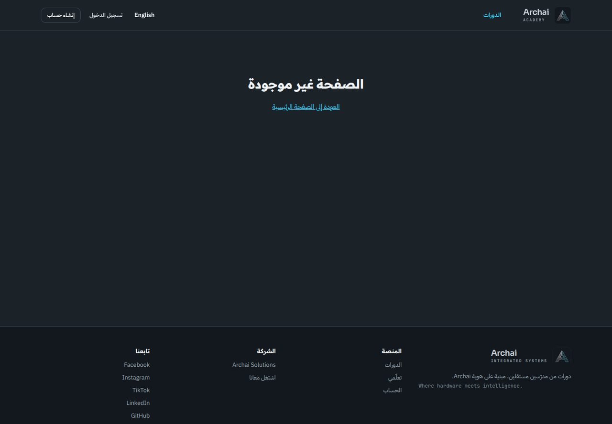

# Archai Academy — Secure Multi-Instructor LMS Marketplace

A production-oriented learning platform where independent instructors build and publish courses, and students learn from protected video, quizzes, assignments and verifiable certificates. A Super Admin owns the platform. **Payments are deliberately not enabled (phase 2)**, but the schema and interfaces are payment-ready.

| Layer | Choice |
|---|---|
| App | Next.js 15 (App Router) · React 19 · TypeScript · Tailwind CSS 3 · shadcn-style components |
| Backend | Next.js Route Handlers + Server Actions (Node runtime), modular `src/lib` services |
| Data & auth | Supabase PostgreSQL, Supabase Auth (password + email confirmation/recovery; no MFA), Row Level Security |
| Video & files | **Cloudflare R2** (private bucket, presigned URLs) — replaces Cloudflare Stream to stay near-free |
| Hosting | Vercel (preview + production) |
| Tests | Vitest + React Testing Library + PGlite (real Postgres engine) + Playwright |

Arabic (RTL) and English (LTR) are first-class, and the whole UI follows the **Archai Design System v2.0** (tokens, fonts, motifs, light-theme documents). See [`docs/`](docs): DESIGN, SPEC_COVERAGE, ARCHITECTURE, SECURITY, OPERATIONS, TESTING, and [Auth/R2 setup](docs/AUTH_AND_STORAGE_SETUP.md).




### Learning experience
Course page with *what you'll learn*, requirements, audience, accordion curriculum with durations, rating breakdown and a sticky purchase card · catalog with sidebar filters, sorting and active-filter chips · player with resume, keyboard shortcuts, autoplay-next, private timestamped **notes**, per-lesson **Q&A** with the instructor, **announcements**, downloads · dashboard with "pick up where you left off" · verifiable certificates (printable light theme).

> **Read this first — what R2 changes.** R2 is object storage, not a video platform. There is no transcoding, adaptive bitrate or HLS. Videos are streamed as progressive MP4/WebM through **short-lived signed URLs** (default 15 min, re-issued and re-authorized automatically while watching). Ask instructors to upload web-optimised H.264/AAC MP4 with "fast start". A signed URL is a bearer link for its lifetime, so this is *access control*, **not DRM** and cannot stop screen recording. Details in [`docs/SECURITY.md`](docs/SECURITY.md).

---

## 1. Prerequisites

- Node.js 22.22.2 or newer (see `.nvmrc`) and npm
- A free [Supabase](https://supabase.com) project
- A free [Cloudflare](https://dash.cloudflare.com) account with R2 enabled (R2 requires a payment method on file, but the free tier — 10 GB storage, 1M Class A / 10M Class B ops per month, **zero egress fees** — covers an initial launch)

## 2. Supabase setup

1. Create a project. Copy the Project URL and anon key; keep the service-role key server-only.
2. Apply every file in `supabase/migrations/` in ascending order (`0001` through `0014`) using the Supabase SQL editor or `npx supabase db push`. Do not re-run older migrations against a database that already recorded them as applied.
3. Optional sample categories: run `supabase/seed.sql`.
4. Authentication → URL Configuration: set Site URL to `NEXT_PUBLIC_SITE_URL`; allow `http://localhost:3000/auth/callback`, `http://localhost:3000/reset-password`, and matching production URLs. Supabase redirects must exactly match configured allow-list entries.
5. Authentication → Providers → Email: choose your email-confirmation policy. Configure custom SMTP for reliable invites, confirmation messages, and password recovery. The built-in mailer is intended for testing, not production. Set a minimum password length of 10+.

## 3. Cloudflare R2 setup

1. Create a private bucket for lesson videos/resources (example: `lms-course-videos`). Never enable public access for this bucket.
2. Create a separate covers bucket (example: `lms-public-covers`). Course covers are public assets; expose only this bucket using an `r2.dev` URL for development or a custom domain for production. Put that exact public base URL in `R2_COVERS_PUBLIC_URL`; do not use the S3 endpoint (`*.r2.cloudflarestorage.com`) as the public image URL.
3. Create an R2 API token with Object Read & Write permissions scoped only to the two required buckets. Copy credentials to server-only `.env.local`.
4. The app uploads covers through the same-origin Next.js API (no browser-to-R2 CORS preflight for covers). Video/resource uploads use signed browser PUT URLs; apply `r2-cors.json` to the private bucket and replace `YOUR-PRODUCTION-DOMAIN`.
5. (Recommended) Configure Cloudflare usage/spend alerts.

## 4. Configure and run

PowerShell on Windows:

```powershell
npm ci
Copy-Item .env.example .env.local  # fill in the values; never commit this file
npm run dev                        # http://localhost:3000
```

macOS/Linux:

```bash
npm ci
cp .env.example .env.local
npm run dev
```

Generate the two random secrets with `openssl rand -hex 32` (`PLAYBACK_HMAC_SECRET`) and `openssl rand -hex 24` (`CRON_SECRET`).

### Create the Super Admin (once)

```bash
npm run bootstrap:admin -- you@example.com "Your Name"
```

The bootstrap script provisions exactly one `super_admin` role for the bootstrap account. Sign in at `/login`; admin permissions are checked server-side and in Postgres RLS. This application intentionally has no two-factor authentication.

1. **Admin → Categories** (or run `seed.sql`).
2. **Admin → Instructors → Invite instructor** (an email invitation lets the instructor set their first password securely).
3. Instructor: create a course → add sections/lessons → upload videos → *Submit for review*.
4. Admin: **Courses → Approve & publish**. Students can now browse and enroll (free courses). Paid courses show a clearly labelled checkout placeholder.


### Troubleshooting sign-in / sign-up

| Symptom | Fix |
|---|---|
| `Could not find the function public.rate_limit_hit … in the schema cache` | Run `supabase/tools/diagnose.sql`. If a function is missing, apply all unapplied migration files in numeric order. Then run `notify pgrst, 'reload schema';`. (The app now keeps sign-in working while the limiter is briefly unavailable.) |
| Login succeeds but you bounce back to `/login` | The auth user has no `profiles` row (created before migrations). The app now self-heals this; you can also run `supabase/tools/repair_and_promote_admin.sql`. |
| Register "works" but no e-mail arrives | Supabase's built-in mailer only sends to a few team addresses. For local testing turn off *Confirm email* (Auth → Providers → Email) or create users in Authentication → Users with *Auto Confirm User*. Configure custom SMTP for production. |
| `npm run bootstrap:admin` | Reads `BOOTSTRAP_SUPER_ADMIN_EMAIL/PASSWORD/NAME` from `.env.local`; add `--reset-password` to set the password on an existing user. |
| Language | The language switch is the button in the header (cookie-based); there are no `/ar` URLs. |
| Node engine / `EBADENGINE` warning | Install Node `22.22.2` or newer as pinned in `.nvmrc`, then remove `node_modules` and reinstall. |

## Performance notes

- Course-card navigation prefetch is disabled to avoid dozens of resource-heavy server renders firing at once on catalog pages.
- Cover images use the Next.js optimizer when `R2_COVERS_PUBLIC_URL` is set to the public r2.dev/custom domain; original images are immutable cached R2 objects.
- Lesson Q&A requests load only when the Q&A tab is opened and are bounded to recent threads/replies; each request independently verifies course access.
- API routes perform their own server-side auth checks, so middleware skips the redundant Supabase `getUser()` call on `/api/*`.
- Apply `0014_performance_indexes.sql` after previous migrations to accelerate common catalog and notification queries.

## 5. Scripts

| Command | Purpose |
|---|---|
| `npm run dev` / `build` / `start` | Next.js |
| `npm run bootstrap:admin -- EMAIL "Name"` | Provision the initial Super Admin; first use only |
| `npm run check` | Typecheck + ESLint + Vitest unit/database suites |
| `npm run verify:static` | Migration order, MFA-removal, i18n-key parity and key security-path checks |
| `npm test` | Unit, component and database/RLS tests (PGlite, no external service needed) |
| `npm run test:e2e` | Playwright HTTP/security tests against a running build (see `docs/TESTING.md`) |
| `npm run watermark:resolve -- ID-XXXXXXXXXX` | Map a leaked watermark back to an account |

## 6. Deploy (Vercel)

Import the GitHub repo, set the environment variables from `.env.example` (Production + Preview), set `NEXT_PUBLIC_SITE_URL` to the real URL, and add that URL to Supabase redirect URLs and the R2 CORS policy. `vercel.json` registers a daily cron for `/api/cron/maintenance` (Vercel passes `CRON_SECRET` automatically). Full checklist: [`docs/OPERATIONS.md`](docs/OPERATIONS.md). Auth and storage setup: [`docs/AUTH_AND_STORAGE_SETUP.md`](docs/AUTH_AND_STORAGE_SETUP.md).

> Vercel's free *Hobby* plan is for non-commercial use. Plan to move to Pro before you charge money (phase 2).

## 7. Project layout

```
supabase/migrations/   0001 schema · 0002 functions/triggers/views · 0003 grants+RLS · 0004 config seed · 0005 admin helpers · 0006 learning experience · 0007 single role/no MFA · 0008–0011 category/cover/role workflow fixes · 0012 subscription catalogue fields · 0013 atomic pricing RPC · 0014 query-performance indexes
src/app/               routes (public, learn, instructor, admin, api)
src/actions/           server actions (auth, instructor, learning, admin)
src/lib/               auth, api wrapper, media (upload/playback), r2, rate-limit, audit, i18n, validation, payments contract
src/components/        UI primitives, player, uploader, quiz, Q&A, cover uploader
tests/                 unit · db (RLS) · e2e (HTTP security)
scripts/               bootstrap-super-admin, resolve-watermark
docs/                  ARCHITECTURE · SECURITY · OPERATIONS · TESTING
```

## 8. Status and known limitations (honest summary)

**Validation included in this source package:** a static verification script (`npm run verify:static`), unit tests for input/media rules, and PGlite-based database/RLS tests designed to execute all SQL migrations. Run `npm run check`, `npm test`, `npm run test:e2e`, and `npm run build` in a clean Node 22.22.2+ environment before deployment; do not treat the static script as a substitute for these checks.

**Must be verified in your environment before production:** clean dependency installation and lockfile integrity; migration execution against a disposable Supabase database; real Supabase invite/confirmation/password-recovery e-mails; cover upload to a correctly configured public covers bucket; private browser media upload/playback; Arabic/English mobile layouts; and screen-reader/keyboard checks. The sandbox used to prepare this build did not have a complete npm dependency install or your live Supabase/R2 credentials, so those provider integrations are not claimed as passed.

**By design / deferred:** no payment processing (phase 2: provider, webhooks, subscription charges, refunds, commissions, payouts — tables and contracts exist); free, one-time, monthly and yearly course pricing can be configured, but subscription renewal is not charged in phase 1; bundles and memberships are modelled in the schema but have no checkout UI; no co-instructor management UI (table exists); support/ticketing workflow not built (review moderation exists); course covers are manually uploaded as JPG/PNG/WebP to a dedicated public R2 covers bucket; video duration is client-reported (R2 cannot probe media); no transcoding/HLS; no DRM; `npm audit` still reports a PostCSS advisory inside Next's bundled build tooling (build-time only, fix requires a Next major upgrade).
