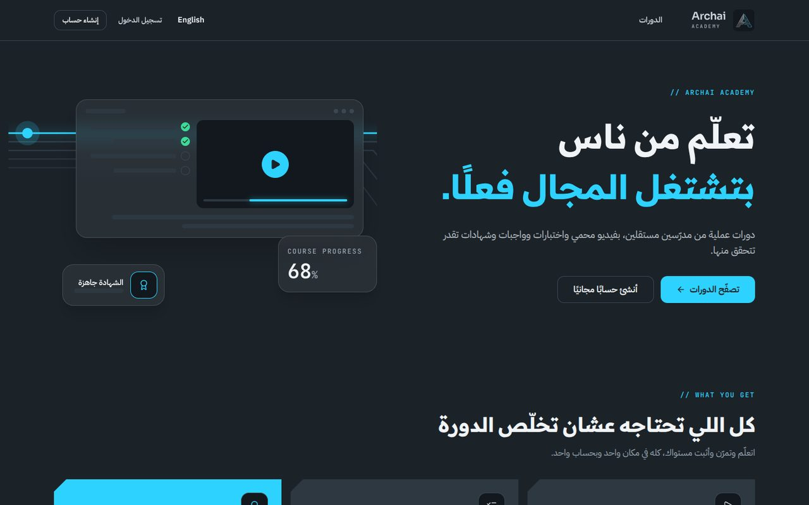

# Design system implementation (Archai Design System v2.0)

The whole UI follows the supplied identity guide (`Archai_Design_System.pdf`). This page records **how each rule was applied, and what was not**.

> Screenshots were produced from sample data against the real build, only to illustrate the theme.

## Tokens (`src/app/globals.css`, `tailwind.config.ts`)

| Guide | Implementation |
|---|---|
| Carbon `#1B2228` 60 % surface · Panel `#222B33` cards · Silver `#CCD3DA` · Arc Blue `#2ED2FF` · Copper `#C48A5C` | CSS variables `--bg / --panel / --silver / --arc / --copper` (RGB channels, so Tailwind opacity works), plus Slate scale (`--deep #12181D`, `--steel #2D3841`, `--line #3A4753`, `--muted #98A5B1`) and semantic `--ok / --warn / --err` |
| Dark is the base, light is the exception | `:root` is dark. `.theme-light` (Paper `#F1F4F7`, Ink, **Arc Ink** `#07739B`, **Copper Ink** `#8A5A36`) is used only for documents: the certificate and print |
| Contrast table | Carbon text on Arc (10:1) for buttons; Arc/Copper only as text on dark; Arc Ink on paper. Paper-on-Arc is never used for text. run axe-core and manual keyboard/screen-reader checks after installing dependencies; the current packaging pass did not run accessibility automation |
| Radius 8 / 12 / 20 / full | `rounded-sm / md / lg` remapped to 8 / 12 / 20 px |
| Motion 120 / 240 / 480 ms, `cubic-bezier(.2,.8,.2,1)` | `duration-fast/base/slow`, `ease-brand`; `prefers-reduced-motion` disables animation |
| Glow `0 0 26px rgba(46,210,255,.28)` | `--glow`, used on focus, primary-button hover, progress and the single "port" per screen — dark surfaces only |
| **No gradient backgrounds** | Honoured. Course covers are flat steel panels with traces. The only gradient is the Chrome bevel (`#E6EAEE → #98A5B1 → #4A5966`, 135°) on frames (`.chrome-edge`) |

## Typography (self-hosted via Fontsource — no Google CDN, CSP stays `font-src 'self'`)

| Role | Family | Used for |
|---|---|---|
| Arabic headlines | Readex Pro (600/700) | `h1–h4` Arabic glyphs |
| Latin display | Sora | `h1–h4` Latin glyphs, prices, big numbers (per-glyph fallback gives each script its own face) |
| Body + UI (Arabic and Latin) | IBM Plex Sans Arabic (400, 600) | everything else |
| Code / specs | JetBrains Mono | `// SECTION` labels, counts, timestamps |

Rules applied: max three weights per page (400 / 600 / 700; Tailwind `font-medium` is remapped to 600); Arabic line-height 1.85 (≥ 1.6); **no letter-spacing on Arabic** (tracked mono labels are Latin only — `<MonoLabel>`); **Latin digits 0–9** everywhere including Arabic (`ar-EG-u-nu-latn`, unit-tested); Latin technical terms inside Arabic use `<Tech>` (ltr, Arc).

## Components and motifs

- **Buttons:** one Arc primary per screen; outline secondary; **copper is reserved for purchase/booking invitations** ("Buy this course", "Talk to us"). Fields use the darker well colour, Arc border + glow on focus, red border when invalid.
- **Badges / alerts:** outlined pills; alerts are tinted with a coloured dot (ok / warn / error) exactly like the guide's alert row.
- **Motifs:** Bus traces (`<Bus>`, `CourseCover`), glowing Port (one per screen), Glass panels (`.glass`, hero preview built from real UI primitives instead of stock images), Chrome bevel (`.chrome-edge`), 45° notched service cards (`.notch`, mirrored in RTL).
- **Icons:** Lucide at 24 px grid / 1.75 stroke inside 48/56 px containers (default / active / filled / glass).
- **Logo:** the mark, favicon, Apple icon and Open Graph image were cropped from the supplied PDF (the app-icon tile). The guide itself notes the logo is raster and a vector master is needed.

## Deviations and open items (honest list)

1. **Logo is raster** (from the PDF pages). Replace `public/brand/mark.png`, `src/app/icon.png`, `apple-icon.png`, `opengraph-image.png` when the official SVG exists.
2. **Icon set:** the guide's custom two-tone icons were not redrawn; Lucide is used with the guide's stroke/grid rules.
3. **Product name** "Archai Academy" is an assumption (`src/lib/brand.ts`, dictionary key `brand`, header descriptor). The guide's channels (social handles, website) are used in the footer; no phone/e-mail is published because the guide marks the company e-mail as undefined.
4. **Voice:** Arabic copy uses simplified MSA for headings and colloquial for CTAs where natural, per the "voice by channel" table. A native copywriter should review all strings in `src/lib/i18n/ar.ts`.
5. **Not in scope for the app:** social templates, banners, reels, lead-gen messaging flows, device labels, PCB silkscreen (guide pages 9–14), and the *Circuit Build* logo-reveal animation (needs the vector mark).
6. Light theme is deliberately limited to documents; there is no user-facing theme switch (the guide says dark is the base).

## Using the system in new screens

Use semantic classes (`bg-background`, `bg-card`, `text-foreground`, `text-muted-foreground`, `border-border`, `text-arc`) and the primitives in `src/components/ui`. Do not hard-code hex values. Keep one Arc button per screen.
